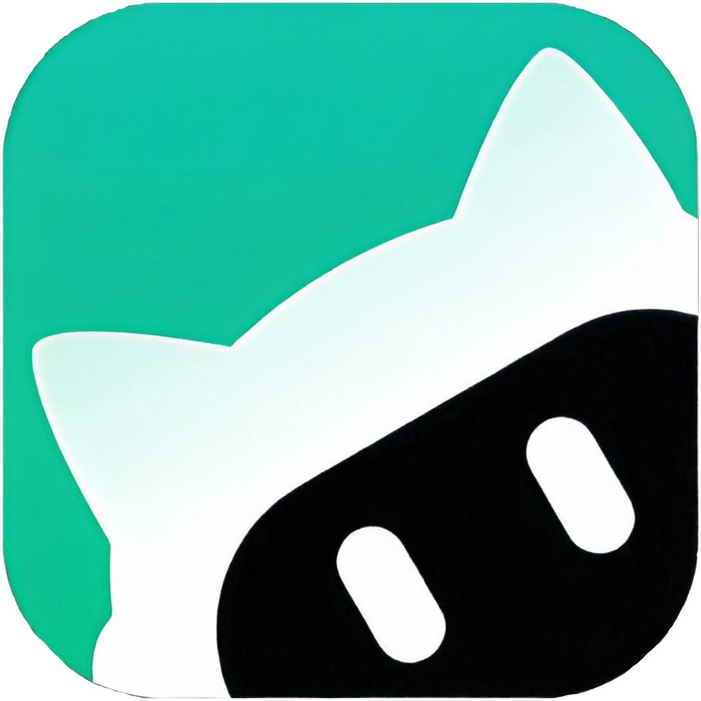
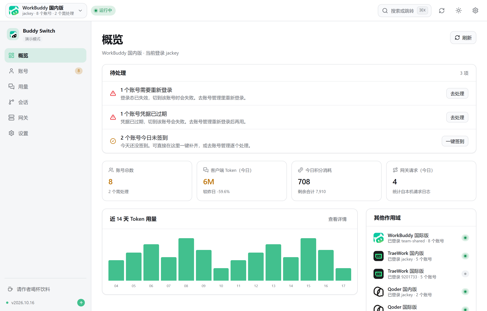
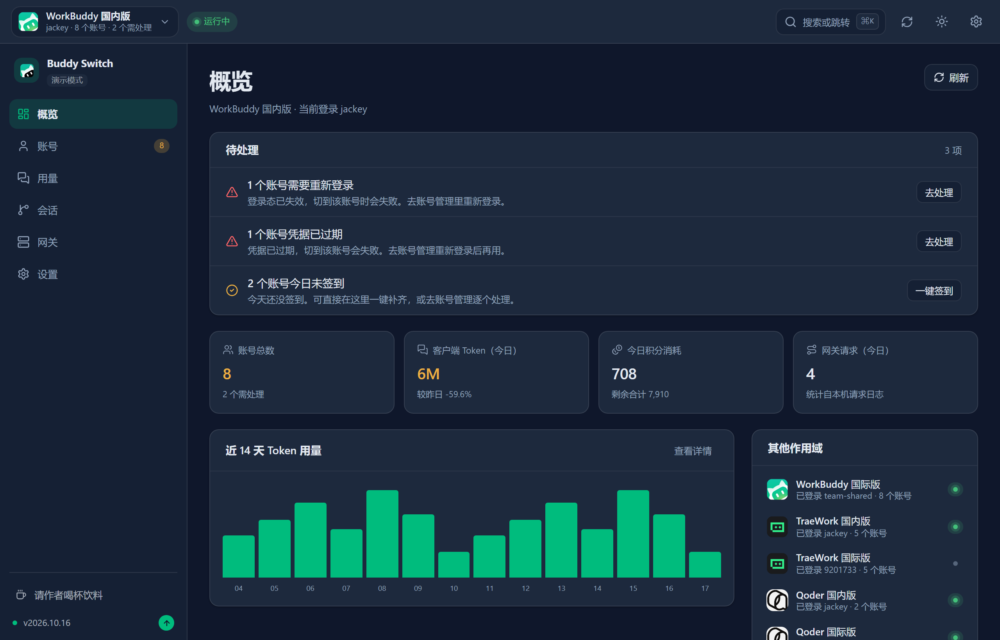
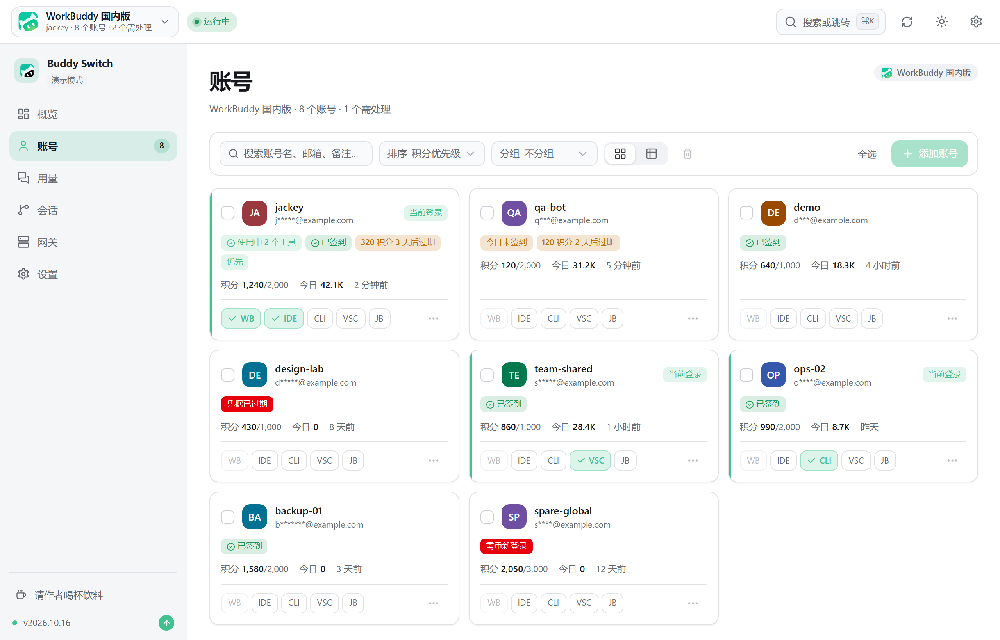
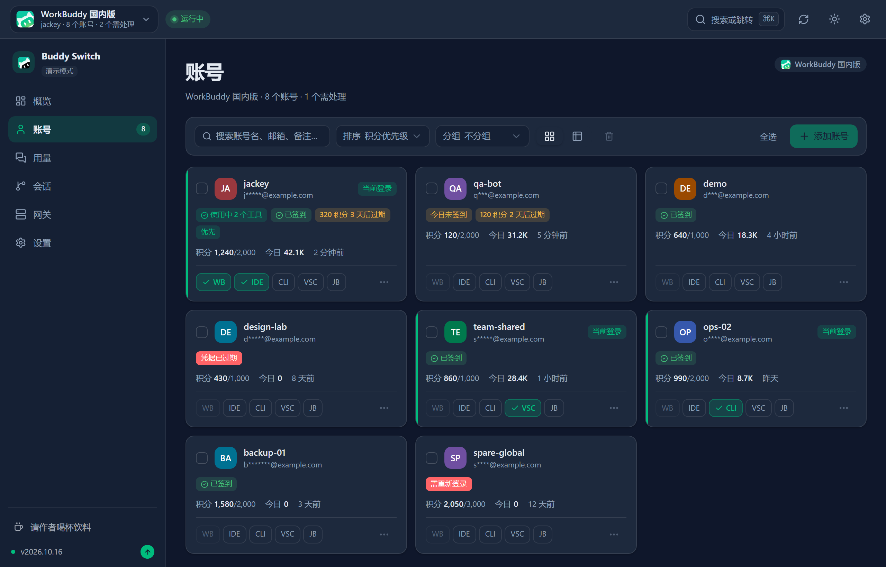
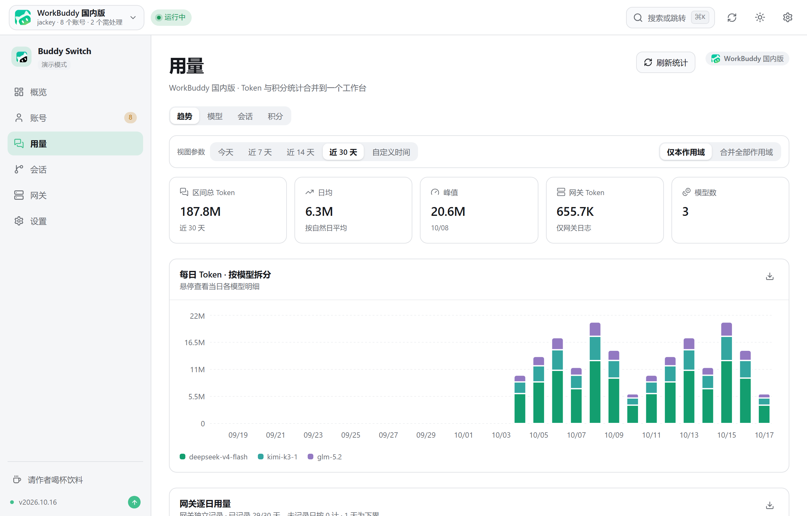
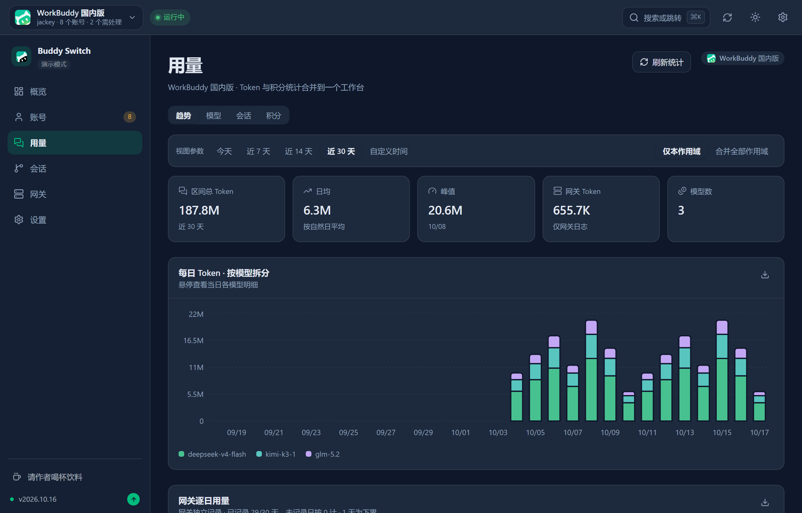
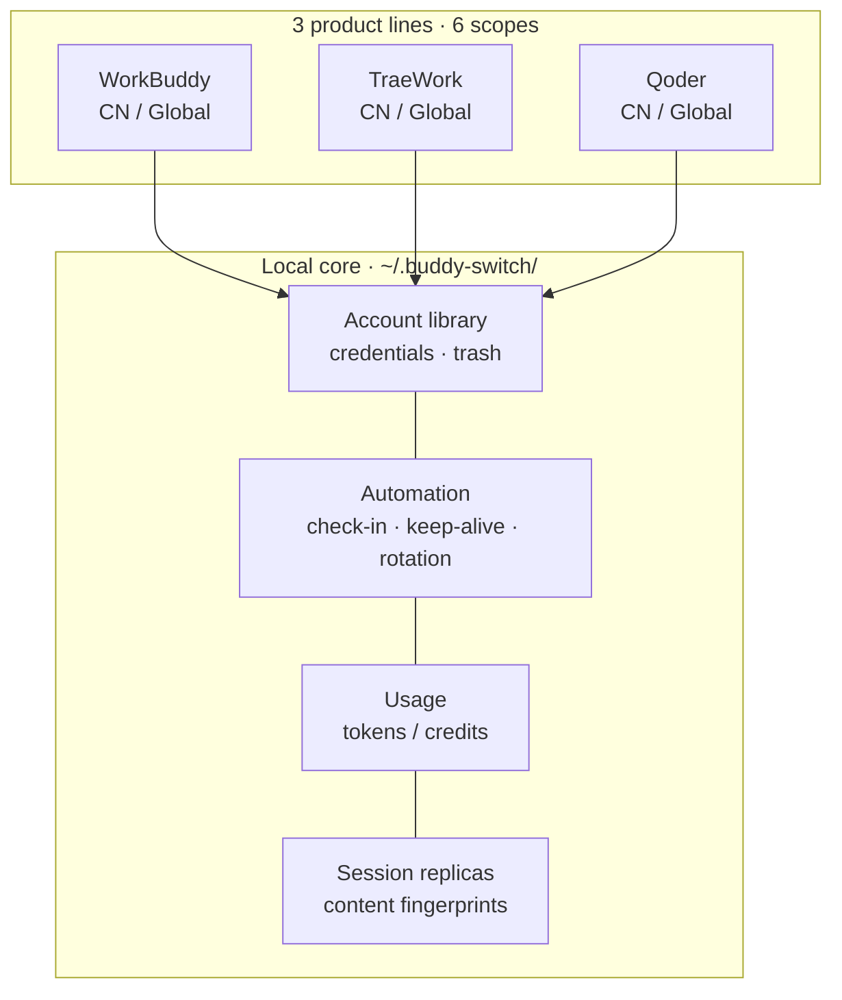
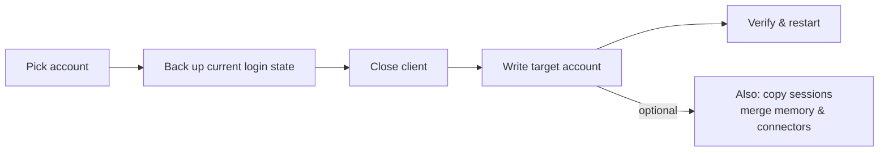
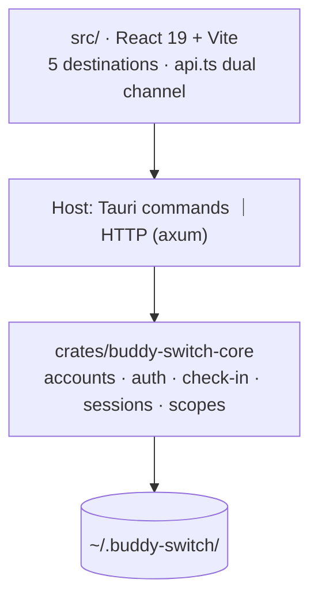

<p align="center">
  
</p>

<h1 align="center">Buddy Switch</h1>

<p align="center">
  <b>WorkBuddy · CodeBuddy · TraeWork · Qoder multi-account workbench</b><br />
  Turn "which account am I signed in with?" into one click
</p>

<p align="center">
  <a href="README.md">简体中文</a> ·
  <strong>English</strong>
</p>

A **local-first** multi-account workbench: it gathers accounts from **WorkBuddy / CodeBuddy / TraeWork / Qoder** across **6 scopes** into one place — QR / device-code sign-in, one-click login-state switching, check-in and credits, usage analytics, and session-replica syncing. All data stays on your machine.

|  |  |
| --- | --- |
| 🪪 **6 scopes on one screen** | 3 product lines × CN / Global, each with an independent account library; switching shows live progress and rolls back on failure |
| ✅ **Todos surface themselves** | The overview lists "needs re-login / not checked in today / credits expiring / client not running" — one click each |
| 📊 **Usage and credits visible** | Tokens, credits, cache hit rate, breakdowns by account / model / session — all in one place |
| 🔁 **Session replicas tracked** | The same conversation replicated across accounts: who lags, who diverged — content-fingerprint + additive sync |

> ⚠️ **Unofficial · non-commercial**: not affiliated with, authorized by, sponsored by, or endorsed by WorkBuddy, CodeBuddy, TraeWork, Qoder or their right holders. The app reads/writes local client auth data and performs automated requests per your configuration. Read the **[Disclaimer](docs/policies/DISCLAIMER.en.md)** before use.

## Screenshots

<table>
  <thead>
    <tr><th>Overview (light)</th><th>Overview (dark)</th></tr>
  </thead>
  <tbody>
    <tr>
      <td></td>
      <td></td>
    </tr>
  </tbody>
</table>

<table>
  <thead>
    <tr><th>WorkBuddy accounts (light)</th><th>WorkBuddy accounts (dark)</th></tr>
  </thead>
  <tbody>
    <tr>
      <td></td>
      <td></td>
    </tr>
  </tbody>
</table>

<table>
  <thead>
    <tr><th>Usage · Trend (light)</th><th>Usage · Trend (dark)</th></tr>
  </thead>
  <tbody>
    <tr>
      <td></td>
      <td></td>
    </tr>
  </tbody>
</table>

> Screenshots are generated by `scripts/gen-readme-shots.mjs` from the demo build (`VITE_DEMO_MODE=1`); accounts, credits and request records are fictional. Re-run it after UI changes.

## The big picture



**Three hard rules** across all features: data stays local, credentials are only written into client login state (no proxy login, no upstream protocol changes), and every write is backed up first.

## Forms

| Form | How | Notes |
| --- | --- | --- |
| **Desktop app** | Build from source (below) | Tauri bundle, recommended for daily use |
| **webui / Docker** | Build from source | Same frontend bundle over a local HTTP channel; see [Docker guide](docs/guides/DOCKER.md) |

## Quick start

**Desktop app (from source)**: the frontend bundle is embedded at compile time — order matters.

```bash
npm install
npm run build                                    # 1) frontend → dist/
cargo build --release -p buddy-switch-rust       # 2) build the desktop app
```

**webui (from source)**:

```bash
npm install
npm run build                                    # 1) frontend → dist/
cargo build --release -p buddy-switch-server     # 2) build the server (embeds dist/)
./target/release/buddy-switch                    # 3) serve + open browser (default 127.0.0.1:57890)
```

```bash
buddy-switch              # serve + open browser
buddy-switch serve        # serve only (--port to change)
buddy-switch status       # current account in the terminal
buddy-switch version      # version
```

<details>
<summary><b>macOS: "damaged" / "cannot verify developer" / permission prompts</b></summary>

- **"BuddySwitch is damaged and can't be opened"** (Gatekeeper's message for unsigned downloads): after moving the app to /Applications run `xattr -dr com.apple.quarantine /Applications/BuddySwitch.app`, then open it normally. This only removes the "downloaded from network" flag.
- "Cannot verify developer": Control-click the app in Finder → Open, or System Settings → Privacy & Security → Open Anyway.
- Switching accounts writes client auth files: grant BuddySwitch **App Management** (or **Full Disk Access**) in System Settings → Privacy & Security, then restart the app. The settings page has a permission check.
- webui form runs with the permissions of the terminal that started it.
- **Repeated keychain prompts**: the client's (Qoder / CodeBuddy IDE) Safe Storage master key lives in the system keychain; the first read always asks once — click "Always Allow". If it asks every time, the app was likely moved or reinstalled — delete the entry in Keychain Access, then reopen the client and BuddySwitch and authorize once more.

</details>

## 6 scopes (platform × region)

The scope picker (top-left) decides which account set you manage. The scope is part of the URL (`/s/wb-cn/accounts`) so refresh, share and history all stay put; `⌘K` / `Ctrl+K` searches across scopes, `⌘1`–`⌘6` switch directly.

| Scope | Platform | Region | Managed clients |
| --- | --- | --- | --- |
| `wb-cn` | WorkBuddy | CN | WorkBuddy desktop, CodeBuddy CN IDE / CLI, VS Code / JetBrains CodeBuddy extensions |
| `wb-global` | WorkBuddy | Global | Same (global clients) |
| `trae-cn` | TraeWork | CN | Trae CN |
| `trae-global` | TraeWork | Global | Trae |
| `qoder-cn` | Qoder | CN | Qoder CN desktop / CLI |
| `qoder-global` | Qoder | Global | Qoder desktop / CLI |

The six scopes are fully independent: own account library, own clients, own settings. Trae's legacy lines (TraeWork / TraeCode) were merged into one client upstream; old identifiers remain for compatibility.

## 5 sidebar destinations

All platforms are structurally identical: **Overview · Accounts · Usage · Sessions · Settings**. Entries are capability-gated (not platform-branched): a missing capability simply renders no entry; deep links get structured empty states.

| Destination | In one line |
| --- | --- |
| **Overview** | Todo list (re-login / check-in / expiring credits / client not running) + stat cards + 14-day token bars + other-scope glance |
| **Accounts** | Card / table views, slot switching, QR or device-code login, local import, check-in, 30-day trash, rate-limit ledger (WorkBuddy only) |
| **Usage** | One workbench, three views: Trend · Sessions · Credits; a single parameter bar (time range + scope) |
| **Sessions** | Replicas of the same conversation across accounts: who lags, who diverged, sync to whom (**WorkBuddy only**) |
| **Settings** | Nine sections: general · accounts & login · check-in & credits · gateway · scheduled tasks · clients · permissions & diagnostics · logs · backup & restore |

### Usage workbench

**Trend**: an "equivalent cost" hero figure (converts tokens to money via your own per-model prices, supports peak/off-peak pricing with a built-in Chinese public-holiday table), input / output / cache-hit-rate cards, a daily token bar chart (per-model breakdown with its own time window), a 1-year calendar heatmap, a usage wave chart, and a model donut whose legend carries per-model four-bucket details.

**Sessions**: the deduplicated session ranking, per-account totals, and a records × tokens scatter.

**Credits**: per-account consumption for the current window, the client ledger by model, and a daily credit-usage chart.

### Capability matrix

| Capability | WorkBuddy | TraeWork | Qoder |
| --- | :---: | :---: | :---: |
| Account library / login / local import | ✅ QR + import | ✅ web login + JWT | ✅ device code + PAT |
| One-click slot switching | ✅ 5 (4 switchable + 1 read-only probe) | ✅ 1 (merged client) | ✅ 2 (desktop / CLI) |
| Check-in / credits | ✅ incl. auto travel, auto rotation | ✅ | ✅ daily campaigns + plans / quota |
| Usage analytics | ✅ tokens + credits | ✅ tokens + credits | ✅ credits only (the client records token counts as 0) |
| Session replica sync | ✅ content fingerprint + additive sync | — | — |

## How switching an account works



- **Back up before writing**: auth files, Trae login-state snapshots and session overwrites all leave a restorable copy first.
- **Verify after writing**: failures roll back automatically; a running client refuses writes to avoid the client overwriting them with stale in-memory state on exit.
- **Deletion is soft**: accounts go to a 30-day trash and can be restored; permanent deletion also clears credentials and snapshots.

## Automation

Scheduled tasks support **minute-granularity** times (e.g. `09:37`), multiple times per day, and **random jitter** (±5/15/30 minutes) so daily triggers don't align on the hour.

| Side | Tasks |
| --- | --- |
| WorkBuddy (6) | check-in · cat travel · activity map · token keep-alive · school season · night owl |
| Trae (2) | check-in · JWT auto-renewal |
| Qoder (2) | check-in · token keep-alive |

Auto rotation (WorkBuddy only) is an **independent background loop**, not a scheduled task — see below.

<details>
<summary><b>Auto rotation policy (WorkBuddy, prevents credit expiry)</b></summary>

A background loop periodically sets the **default account for subsequent CodeBuddy CLI launches** to the "most urgent" account (earliest expiry with remaining credits). Checks in order:

1. Valid account (query OK, not expired, credits remaining)
2. Urgency check (most urgent has more than `min_urgency_hours` left, default 72h → skip)
3. Already the target → skip
4. Cooldown (`cooldown_minutes`, default 120)
5. Active guard (conversation within `active_guard_minutes`, default 30 → skip)
6. Value filter (remaining credits below `min_remaining_credits` → not worth switching)
7. Debounce (difference below `min_gap_hours`, default 24 → skip)

**Boundary**: only the default account for future sessions changes; the current session is never hot-switched — reload via ACP or restart the CLI.

</details>

<details>
<summary><b>App-level capabilities (shared across all scopes)</b></summary>

| Capability | Notes |
| --- | --- |
| App settings (⚙ in the title bar) | Theme (light / dark / OLED black / system), UI language (简体中文 / English), silent launch, close-to-tray |
| Global backup & restore | Covers all scopes at once, selectable per section (accounts / settings), **credentials excluded by default** |
| Skill management | Scans `skills/*/SKILL.md`, per-item enable/disable (line-level rewrite, all other bytes untouched), cross-region moves, zip import |
| Client settings hosting | Reads/writes the upstream clients' own `settings.json`: 6 slot specs + format fingerprint + byte-level minimal patches + backup / restore / diff |
| Session floating window (desktop only) | A separate small window showing cross-source task status; read-only, click through to the original session |
| Runtime logs | This app's **own** log (`~/.buddy-switch/logs/runtime-YYYY-MM-DD.log`), filterable by level / date / keyword in Settings → Logs. 7-day retention, 4 MiB per file, up to 4 shards per day; credentials are redacted before hitting disk. `BUDDY_SWITCH_LOG_LEVEL=debug` + restart for per-request detail |

</details>

## Data and privacy

- All data lives in local `~/.buddy-switch/`; nothing is uploaded to third-party services. UI preferences stay local.
- Account libraries are per-scope (e.g. `accounts.json` / `accounts.global.json`, `trae/checkin_accounts*.json`).
- Exported backups **exclude tokens by default**; writing plaintext requires explicit opt-in, double confirmation, and an on-page warning that the file can be used to log in.
- Runtime logs stay local and are **redacted before writing** (token params, `Bearer` values, JWTs).

## Development



```bash
npm install
npm run tauri dev     # desktop development
npm run build         # frontend build + contract / scope / platform gates
npm run check:api     # validate the frontend API contract only
```

```
crates/
  buddy-switch-core/     # accounts, auth, OAuth, processes, switching, sessions, check-in, regions, Trae / Qoder modules
  buddy-switch-gateway/  # OpenAI / Anthropic compatible gateway
  buddy-switch-server/   # HTTP server + CLI (axum API + rust-embed frontend)
src-tauri/               # desktop host (thin Tauri command wrappers + tray)
src/                     # frontend: components / pages / lib / locales
```

## Docs

Full index at [docs/README.md](docs/README.md). The most-read ones:

| Doc | What it covers |
| --- | --- |
| [guides/DEVELOPMENT.md](docs/guides/DEVELOPMENT.md) | Requirements, local development, gates, release flow, layout |
| [guides/DOCKER.md](docs/guides/DOCKER.md) | Container deployment: build, ports & security, troubleshooting |
| [policies/](docs/policies/) | License and disclaimer |

## Credits

- **[changexbc/workbuddy-switch](https://github.com/changexbc/workbuddy-switch)** (MIT) — foundation of the account data format, multi-account switching, and credit / token analytics.
- **[Sliverkiss/workbuddy2api](https://github.com/Sliverkiss/workbuddy2api)** — the idea of exposing model quota via an OpenAI-compatible endpoint.

Product names and trademarks belong to their respective owners.

## License

**[PolyForm Noncommercial License 1.0.0](./LICENSE)**: personal non-commercial use allowed; **commercial use is not licensed**.

- Full terms: [LICENSE](./LICENSE); plain-language notes in [docs/policies/LICENSING.en.md](docs/policies/LICENSING.en.md)
- Full disclaimer: [docs/policies/DISCLAIMER.en.md](docs/policies/DISCLAIMER.en.md)
- This is a personal project with no commercial support, SLA, or maintenance promise.
